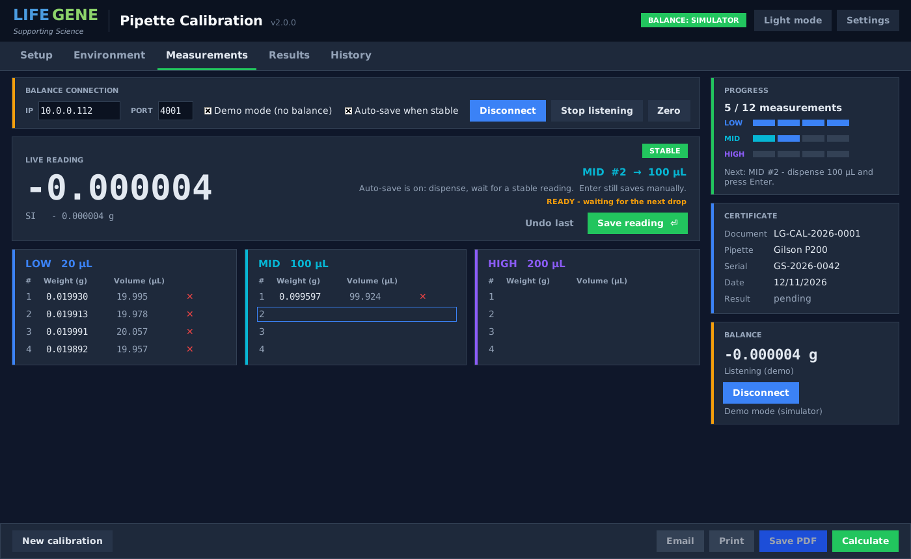

# LifeGene Pipette Calibration

Desktop program for the gravimetric calibration of Gilson pipettes with a
RADWAG analytical balance. It reads the balance live, records 4 weights at
the LOW / MID / HIGH test volume, converts them to volume, checks the
systematic and random error against the lab's acceptance limits and produces
a two-page PDF calibration certificate.



## What is new in version 2

Version 1 was a single 40 KB script. Version 2 is the same workflow rebuilt as
a small, tested application:

* **Package structure** - physics, statistics, balance protocol, certificate,
  storage and GUI are separate modules with 40 unit tests (`pytest`).
* **Correct physics** - Z factor from water density (Tanaka 2001) and an air
  buoyancy correction; values match the ISO 8655-6 reference table.
  The Environment tab shows water density, air density and Z live.
* **Expanded uncertainty (k = 2)** per test volume on screen and on the certificate.
* **Demo mode** - a built-in balance simulator, so the program can be learned,
  demonstrated and tested without hardware ("Simulate drop" button).
* **Robust balance link** - background polling thread, tolerant parser
  (detached sign, `?`, `XS`/`XI`, `g`/`mg`), automatic reconnect message after
  repeated errors, Tare after every saved reading, Enter saves.
* **Calibration history** - every calculation is stored in a local SQLite
  database (document number, pipette, verdict, all raw weights). Document
  numbers are generated automatically (`LG-CAL-2026-0001`, ...), a certificate
  can be re-created from history at any time, and the Setup tab warns when a
  serial number was calibrated before.
* **Settings dialog** - operator name (default "LifeGene Technical Service"),
  e-mail recipient, standard / procedure line, balance readability, default
  environment, PDF folder, next-calibration interval. Stored per user in
  `%APPDATA%\LifeGene\PipetteCalibration`.
* **Certificate** - the approved LifeGene / Gilson layout: logo and address,
  navy title banner, Document / Operator / Date / RESULT bar, three info
  columns (air and water temperature, pressure, humidity, Z factor, Standard
  W-004-04), one results block per test volume with normalised limits,
  "Canal 1" results row with A / CV marks, individual weights and volumes;
  page 2 with signature, contact details, decision-rule notes, the bold
  scope-of-calibration notice in a blue box, and the "shall not be reproduced
  except in full" footer. Always exactly two pages, no clipped text.
* **Full PIPETMAN catalogue** - Classic, Neo (N), L and Multi models with the
  original tip assignments (GS-10, DF30, D100, DF200, DF1000, ...).
* **Dark / light theme**, maximised window, logo from `assets/logo.png`.
* **Windows helpers** - `install.bat`, `run.bat`, and `build_exe.bat`
  (PyInstaller) to hand out a single `PipetteCalibration.exe`.

## Ready-made Windows program (no Python needed)

Every push of this folder builds `PipetteCalibration-<version>.exe` on a
Windows runner (`.github/workflows/build-pipette-exe.yml`) and publishes it
under **Releases** in this repository, together with a zip that contains the
README and a SHA256 list. Download the EXE, put it in any folder (optionally
with a `logo.png` next to it) and double-click it. Windows SmartScreen may
warn because the file is not code-signed: choose *More info* and *Run anyway*.
Settings and the calibration history are stored per user in
`%APPDATA%\LifeGene\PipetteCalibration`, and `app.log` in the same folder
records any error.

To build the EXE yourself on a Windows PC run `build_exe.bat`.

## Installation from source (Windows)

1. Install Python 3.10 or newer from python.org (tick *Add python to PATH*).
2. Copy this folder anywhere (e.g. `C:\PipetteCalibration`).
3. Double-click `install.bat` once.
4. Start the program with `run.bat`, or

```bash
python gilson_calibration.py
```

Optional: put the company logo in `assets/logo.png` (PNG, 400 px high or more).
For e-mail through Outlook the `pywin32` package is installed by `install.bat`;
without Outlook the default mail client opens instead.

## Daily use

1. **Setup** - choose the model, enter the serial number. Tip, document number,
   calibration date, next calibration (+12 months) and place are filled in
   automatically and can be edited.
2. **Environment** - air temperature, pressure, humidity, water temperature,
   balance ID. Water density, air density and the Z factor update live.
3. **Measurements** - the program connects to the saved balance address
   (10.0.0.112 : 4001 by default) when it starts; *Connect* is also in the
   sidebar. The live reading is always shown. With **Auto-save when stable**
   (default) you only dispense: as soon as the balance reports a stable
   reading that has not moved for three readings over at least 0.8 s, and
   that is at least 30 % of the expected mass, the weight is stored, the
   balance is tared, a beep confirms, and the next slot is armed once the pan
   reads zero again. **Enter** or *Save reading* still save manually. *Zero* /
   *Tare* / *Undo last* / per-slot ✕ are available. After the 12th weight the
   results are calculated automatically.
4. **Results** - PASS / FAIL with all figures. Nothing is saved to disk until
   you choose **Save PDF**, **Print** or **Email** in the footer.
5. **History** - search past calibrations, re-create a PDF, or load one back
   into the form.

## Pipette models and limits

Single channel P2, P10, P20, P100, P200, P1000, P5000, P10mL and
multichannel P8x / P12x 10, 20, 200, 300, 1200. Test volumes and the
systematic / random error limits are listed in `pipette_cal/models.py`; see
`docs/PROTOCOL.md` for the formulas and the balance protocol.

## Development

```bash
python -m pip install -r requirements-dev.txt
python -m pytest
python -m pipette_cal
```

| Module | Purpose |
|--------|---------|
| `pipette_cal/models.py` | pipette specs, test volumes, acceptance limits |
| `pipette_cal/physics.py` | water / air density, Z factor, weight to volume |
| `pipette_cal/stats.py` | mean, SD, errors, CV, uncertainty, pass/fail |
| `pipette_cal/scale.py` | RADWAG TCP protocol, parser, polling thread, simulator |
| `pipette_cal/certificate.py` | PDF certificate (reportlab) |
| `pipette_cal/storage.py` | settings file, SQLite history, document numbers |
| `pipette_cal/report.py` | open / print / e-mail the PDF |
| `pipette_cal/app.py` | Tkinter GUI |

The calibration is an internal, non-accredited procedure. The certificate
says so explicitly; do not remove that notice.
